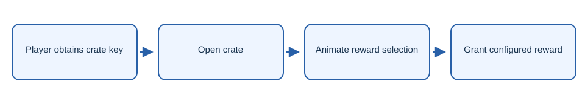

# NeonCrates

Paper and Folia crate plugin with keys, rewards, and roulette animations.

## What it does

- Interactive crate opening interface.
- Virtual and physical keys.
- SQLite backed key storage.

## Getting started

Build with `mvn package`, then place the JAR from `target/` in your server’s `plugins/` directory.

## Security

Keep credentials in local environment files. The example files contain placeholders only. Rotate any credential previously used in a local deployment before publishing or redeploying.

## License

The project code is licensed under AGPL-3.0-only. See [LICENSE](LICENSE).
